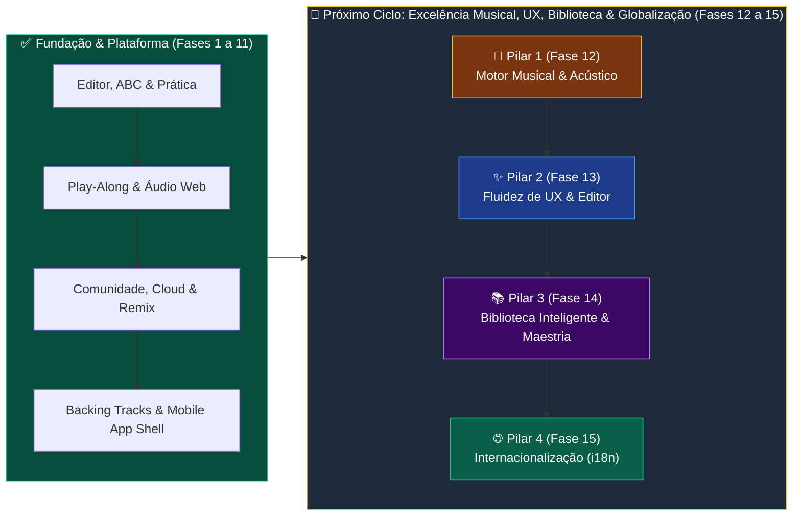

# 🍀 Tin Whistle Live — Roadmap & Planejamento Estratégico

> **Plataforma Oficial:** [https://tinwhistle.live](https://tinwhistle.live)  
> **Repositório:** [xfox26/Whistle-Tab-Editor](https://github.com/xfox26/Whistle-Tab-Editor)  
> **Status:** Ativo • Zero-Build Vanilla ES6 / CSS Modular • Deploy Contínuo na VPS Oracle Cloud

---

## 📊 Visão Geral da Arquitetura & Evolução

---

## ✅ Fases Concluídas (Histórico Consolidado)

### ✅ Fase 1: Edição & Notação Musical
- [x] Suporte completo a **Notação ABC** (importação/exportação compatível com TheSession.org).
- [x] Fórmulas de compasso (4/4, 6/8, 3/4, 2/4, 9/8, etc.) e barras de compasso/repetição (`|:`, `:|`).
- [x] Ornamentações tradicionais de Tin Whistle (*Cut*, *Strike*, *Roll*, *Cran*, *Slide*) com renderização visual e sintetização acústica.
- [x] Linha de cifras harmônicas de violão/bouzouki sobre as notas.
- [x] Histórico de edição infinito (Undo `Ctrl+Z` / Redo `Ctrl+Y`) e seleção em bloco (copiar/colar/duplicar).

### ✅ Fase 2: Modo Prática & Treinamento
- [x] Interface dedicada para **Estudo & Treino** com foco visual e sem distrações.
- [x] **Loop A-B** para repetição contínua de trechos e frases musicais.
- [x] **Count-in** (metrônomo de 1 compasso de contagem prévia).
- [x] **Bordão Celta Contínuo (Drone)** afinado na tônica e quinta (estilo *Uilleann Pipes*), exclusivo e controlado manualmente nos modos Treino e Play-Along.
- [x] **Speed Trainer** (aumento progressivo automático de BPM a cada repetição).
- [x] Zoom da tablatura de 85% a 140% para leitura na estante.

### ✅ Fase 3: Biblioteca, Curadoria & Repertório
- [x] Arquitetura integrada de dados com IDs permanentes aleatórios de 8 caracteres (`?tune=XXXXXXXX`) para todo o catálogo curado, criações e remixes.
- [x] Painel colapsável de filtros rápidos (Estilo/Categoria, Nível de Dificuldade, Ritmo, Ordenação) com contador de filtros ativos e busca instantânea.
- [x] Acervo nativo de 17 clássicos celtas e temas populares (*Concerning Hobbits*, *Song of Storms*, *Star of the County Down*, *Kesh Jig*, *Titanic*, *Pirates of the Caribbean*, etc.).
- [x] Menu lateral colapsável com memorização de estado e botão de reset de fábrica na Central de Importação/Exportação.

### ✅ Fase 4: Visualização, Layout & Exportações Ricas
- [x] Personalização de visualização: ligar/desligar nomes de notas, cifras, durações ou modo dedilhado puro.
- [x] Exportação gráfica vetorial pura (**SVG**) e imagem em alta resolução (**PNG 300 DPI**).
- [x] Exportação de arquivo **Standard MIDI (.mid)** e áudio **WAV Estéreo 44.1kHz** sintetizado diretamente no navegador via `OfflineAudioContext`.
- [x] Temas visuais: *Pergaminho Celta*, *Dark Obsidian*, *Palco Noturno*, *Papel Claro* e *Impressão P&B*.

### ✅ Fase 5: Play-Along Interativo por Microfone
- [x] Motor de detecção de pitch em tempo real (autocorrelação com interpolação parabólica e filtro biquad passa-faixa 250Hz–2200Hz para Tin Whistle).
- [x] Calibração adaptativa de ruído ambiente (*Noise Gate* de 2 segundos).
- [x] Modo **Passo a Passo** (*Wait for Me*) com detecção inteligente de pausas entre notas iguais repetidas.
- [x] Modo **No Ritmo** (*Flow Mode*) com avaliação de precisão temporal e afinação em cents.
- [x] Controles independentes de **Áudio Guia** (flauta sintetizada) e **Acompanhamentos** (banda celta) no Play-Along.
- [x] Relatório pós-treino com pontuação, acurácia %, combo de acertos e medalhas celtas.

### ✅ Fase 6 & 7: Infraestrutura VPS, PWA Android & Ergonomia de Palco
- [x] **Domínio Próprio & VPS Oracle:** `https://tinwhistle.live` com HTTPS/SSL Let's Encrypt e deploy contínuo via GitHub Actions.
- [x] **Screen Wake Lock API:** Impede a tela do celular/tablet de apagar durante a execução musical.
- [x] **Arquitetura PWA & Offline-First:** Manifesto Web (`manifest.webmanifest`), ícones maskable e Service Worker (`sw.js`).
- [x] **Favoritos (⭐) & Ordenação do Repertório:** Marcação rápida de músicas favoritas com persistência local.

### ✅ Fase 8: Plataforma Comunitária, Contas de Bardo & Sistema de Remix
- [x] **Banco de Dados SQLite Persistente (`node:sqlite`) & API RESTful Nativa:** Autenticação segura com `scryptSync` e Frase de Recuperação de 8 palavras.
- [x] **Ciclo de Vida e Visibilidade:** Alternância rápida entre Privada (`🔒`) e Pública (`🌍`) mantendo o mesmo ID e link único, com auto-sync em tempo real.
- [x] **Modo Somente Leitura & Remix (`🔀`):** Proteção automática de partituras oficiais e de terceiros, permitindo criar variações editáveis com créditos automáticos ao autor original.
- [x] **Sincronização Offline Inteligente:** Indicador `💾 Apenas local` exclusivo para alterações pendentes de envio ao banco de dados.

### ✅ Fase 9, 10 & 11: Áudio Polifônico (Backing Tracks) & Reformulação Mobile App Shell
- [x] **Acompanhamentos Acústicos Vinculados à Música:** Bodhrán celta, Violão DADGAD e Irish Bouzouki salvos por partitura, com isolamento de sessão nos modos Treino e Play-Along.
- [x] **Gravador de Demonstração Acústica (30s):** Gravação de áudio real pelo autor da partitura.
- [x] **Mobile App Shell (`100dvh` & Safe Areas):** Top bar compacta unificada, menu dropdown de ações rápidas `[⋯]`, gaveta de repertório com backdrop touch e suite automatizada de auditoria (`npm run audit:mobile`) com zero overflow horizontal.

---

## 🚀 Próximo Ciclo de Evolução: Pilares Musical, UX, Biblioteca & Internacionalização

As melhorias identificadas na auditoria geral do aplicativo estão estruturadas em **4 Fases independentes por Pilar**, divididas em etapas claras de implementação.

---

### 🎵 Fase 12 — Pilar 1: Aperfeiçoamento do Motor Musical & Acústico
*Foco: Fidelidade à tradição irlandesa, precisão de estrutura musical (AABB), continuidade rítmica da banda de acompanhamento e expressividade sonora.*

#### Etapa 12.1: Suporte Completo a Ritornelos Múltiplos (AABB) e Repetições no Play-Along
- [ ] **Controle Individual de Ritornelos (`|:` e `:|`):** Substituir a flag booleana única `repeatHasPlayed` por um conjunto `playedRepeatEndIndices = new Set()`, permitindo que músicas com estrutura tradicional **AABB** (ou **AABBCC**) repitam corretamente cada seção.
- [ ] **Ritornelos no Modo Play-Along:** Atualizar `getPlayableNoteIndices()` (com toggle opcional *"Respeitar Repetições `|:` `:|`"* na barra do Play-Along) para expandir a sequência de notas tocáveis seguindo a estrutura real de repetição da partitura.
- [ ] **Reset Inteligente de Repetições:** Limpar o histórico de ritornelos executados ao reiniciar a música, ao completar um ciclo do Loop A-B ou ao reposicionar o cursor manualmente.

#### Etapa 12.2: Groove Contínuo de Backing Tracks em Notas Longas & Swing Celta (*Lilt*)
- [ ] **Subdivisão Contínua em Notas Longas e Pausas:** Refatorar [`scheduleBackingTrackStep()`](file:///home/antigravity/xfox26/Whistle-Tab-Editor/src/audio/backingTracks.js) para agendar todos os pulsos rítmicos de Bodhrán e dedilhados de Violão DADGAD/Bouzouki ao longo de toda a duração de notas longas (mínimas, semibreves e mínimas pontuadas), evitando que a banda fique em silêncio enquanto a flauta sustenta uma nota.
- [ ] **Controle de Swing Celta (*Lilt*):** Adicionar parâmetro de *Swing / Lilt* (Leve / Tradicional / Reto) no modal de acompanhamentos e no motor de reprodução, aplicando a assimetria temporal característica de *Reels* e *Jigs* irlandeses às colcheias consecutivas.

#### Etapa 12.3: Ornamentos Diatônicos Reais & Articulação de Sopro (*Slur / Breath*)
- [ ] **Cálculo Diatônico de *Cut*, *Strike*, *Roll* e *Cran*:** Atualizar [`scheduleWhistleVoice()`](file:///home/antigravity/xfox26/Whistle-Tab-Editor/src/audio/synthEngine.js) para que as notas de graça utilizem a frequência exata do grau adjacente da escala ativa da flauta (ex: em Ré Maior, um *Cut* sobre `F#5` bate em `G5` e não em `G#5`), além de aplicar a sequência autêntica de cortes múltiplos para o *Cran* sobre o Ré grave (`D5`).
- [ ] **Marcação de Ligadura (*Slur*) e Respiração (*Breath Mark*):** Permitir marcar notas ligadas (tocadas em um único sopro contínuo sem ataque de ruído/língua) e marcas de respiração (`'`) entre frases musicais, refletindo tanto na renderização visual quanto na síntese de áudio.

---

### ✨ Fase 13 — Pilar 2: Fluidez de UX, Edição Visual & Feedback de Prática
*Foco: Eliminar caixas de diálogo nativas bloqueantes (`prompt`/`alert`), acelerar o fluxo de estudo e dar feedback visual imediato para composição e embocadura.*

#### Etapa 13.1: Popovers Visuais Inline (Acordes & Durações) e Fim de Diálogos Nativos
- [ ] **Popover Rápido de Acordes Celtas:** Substituir o `prompt()` nativo ao clicar na cifra da nota por um popover flutuante com botões de 1 clique para os acordes da tonalidade (`D`, `G`, `A`, `Bm`, `Em`, `C`, `Am`, `Dm`, `F#m`), botão de limpar e campo de digitação rápida.
- [ ] **Popover Completo de Durações Rítmicas:** Ao clicar no símbolo de duração da nota, exibir todas as figuras rítmicas suportadas (`0.25` Semicolcheia, `0.5` Colcheia, `1.0` Semínima, `1.5` Semínima Pontuada, `2.0` Mínima, `3.0` Mínima Pontuada e `4.0` Semibreve), preservando compassos compostos (6/8, 9/8) e ternários (3/4).
- [ ] **Padronização total com Toasts Não-Bloqueantes:** Substituir os `alert()` remanescentes de importação, exportação e curtidas por notificações elegantes via `showNotificationToast()`.

#### Etapa 13.2: Seek Instantâneo na Reprodução & Loop A-B em 1 Clique
- [ ] **Seek Musical em Tempo Real:** Permitir que, ao clicar em qualquer nota durante a reprodução ativa (`isPlaying === true`), o cursor de áudio salte imediatamente para aquela nota e continue tocando sem interromper o fluxo.
- [ ] **Atalho "🔁 Loop na Seleção" e Loop por Compasso:** Na barra flutuante de seleção de notas (quando 2 ou mais notas estão selecionadas) e no cabeçalho de cada barra de compasso, adicionar um botão de 1 clique que define automaticamente os pontos `[A]` e `[B]` e ativa o Loop.

#### Etapa 13.3: Validador de Compasso no Estúdio & Assistente de Sopro no Play-Along
- [ ] **Indicador de Soma de Tempos por Compasso (Modo Estúdio):** Exibir discretamente junto ao número de cada compasso o status de preenchimento rítmico (ex: `✓ 4/4` em verde quando completo, ou `⚠️ 3/4` / `4.5/4` em âmbar quando incompleto ou excedido), mais opção de **Auto-Barra de Compasso** ao atingir o limite do compasso.
- [ ] **HUD de Assistência de Oitava e Sopro no Play-Along:** Quando o microfone detectar a nota certa na oitava errada (erro clássico de pressão de sopro na Tin Whistle) ou desvio de afinação constante, exibir dicas em tempo real no painel do Play-Along: *"💨 Sopre um pouco mais firme (2ª Oitava)"* ou *"🍃 Suavize o sopro (1ª Oitava)"*.

---

### 📚 Fase 14 — Pilar 3: Evolução da Biblioteca de Músicas, Descoberta & Maestria
*Foco: Transformar a biblioteca em um ambiente vivo de estudo, descoberta rápida de repertório e acompanhamento da evolução técnica do músico.*

#### Etapa 14.1: Preview de Áudio Rápido (`▶`) Direto na Lista da Biblioteca
- [ ] **Botão de Mini-Preview nos Cards da Sidebar:** Adicionar um botão compacto `▶` em cada item da biblioteca que sintetiza (ou reproduz a gravação demo real, se existir) os primeiros compassos da música diretamente na lista, permitindo ouvir e escolher uma melodia sem perder a partitura atualmente aberta no editor.

#### Etapa 14.2: Análise Automática de Tessitura (Alcance) & Filtros para Iniciantes
- [ ] **Cálculo Automático de Metadados Técnicos da Partitura:** Analisar automaticamente as notas de cada música para gerar indicadores visuais e filtros de busca:
  - `🟢 Só 1ª Oitava` (excelente para iniciantes ou treino silencioso à noite).
  - `🔵 1ª e 2ª Oitava` (extensão padrão).
  - `🟣 Usa Meio-Furo / 7ª Menor` (identifica músicas com `C5`/`C6` natural).
  - `⏱️ Duração Estimada & Nº de Compassos` exibidos no card da música.
- [ ] **Filtro por Alcance e Botão "🎲 Surpreenda-me":** Adicionar filtro rápido para *"Apenas 1ª Oitava"* no painel de filtros e botão de sorteio inteligente de música para prática do dia.

#### Etapa 14.3: Sistema de Progresso Pessoal (*Maestria do Bardo*)
- [ ] **Histórico de Desempenho por Música:** Salvar automaticamente a melhor pontuação/precisão obtida no Play-Along (ex: badge `🏆 98%`) e o maior BPM concluído no treino de cada música.
- [ ] **Marcadores de Estudo Pessoal:** Permitir que o músico classifique qualquer música da biblioteca com seu status de repertório: `🌱 Aprendendo`, `🔥 Praticando` ou `👑 Dominada`, com filtro dedicado na biblioteca.

#### Etapa 14.4: "Sets" Tradicionais Irlandeses (Medleys / Listas de Sessão) & Sugestões
- [ ] **Modo Set / Medley de Sessão:** Permitir agrupar 2 ou 3 músicas do mesmo ritmo (ex: um Set de 3 *Jigs* ou 2 *Reels*) para tocar em sequência contínua ou avançar com 1 clique (`⏭ Próxima do Set`), espelhando a prática real das *Irish Pub Sessions*.
- [ ] **Recomendações de Repertório Semelhante:** Ao concluir uma sessão de Play-Along ou visualizar uma música, sugerir automaticamente 2 partituras compatíveis do catálogo (mesmo ritmo, tonalidade e nível de dificuldade próximo).

---

### 🌐 Fase 15 — Pilar 4: Internacionalização (i18n) & Suporte Multi-Idiomas Automático
*Foco: Tornar o `tinwhistle.live` acessível globalmente (especialmente para a comunidade internacional de Irish Trad & Tin Whistle), com detecção automática de idioma, zero dependências externas e troca instantânea sem recarregar a página.*

#### Etapa 15.1: Motor de Internacionalização Leve em Vanilla ES6 (`src/i18n/`)
- [ ] **Arquitetura Zero-Build Baseada em Dicionários Modulares:** Criar `src/i18n/index.js` e dicionários estruturados por idioma (`pt.js` — Português, `en.js` — Inglês, `es.js` — Espanhol), mantendo 100% de compatibilidade com a arquitetura nativa ES6 e cache offline do Service Worker.
- [ ] **Hierarquia Inteligente de Detecção Automática de Idioma:**
  1. Parâmetro explícito na URL (`?lang=en`, `?lang=pt`, `?lang=es`) para compartilhamento direcionado.
  2. Preferência salva pelo usuário no `localStorage` (`celtic_whistle_lang`).
  3. Detecção automática do navegador/sistema operacional via `navigator.languages` e `navigator.language` (ex: `pt-BR`/`pt-PT` -> `pt`, `es-*` -> `es`, demais idiomas -> fallback universal para `en`).
- [ ] **Função Reativa `t(key, vars)` com Interpolação:** Suporte a variáveis dinâmicas (ex: `t('sidebar.songsCount', { shown: 17, total: 17 })`), pluralização e atualização automática do atributo `<html lang="...">` e metatags de título/descrição.

#### Etapa 15.2: Marcação Declarativa do DOM (`data-i18n`) & Seletor de Idioma na UI
- [ ] **Tradução Declarativa Instantânea no HTML:** Mapear elementos estáticos de [`index.html`](file:///home/antigravity/xfox26/Whistle-Tab-Editor/index.html) com atributos declarativos:
  - `data-i18n="chave"` para textos internos (`textContent`).
  - `data-i18n-title="chave"` para dicas de ferramentas (`title`).
  - `data-i18n-placeholder="chave"` para campos de busca e formulários (`placeholder`).
  - `data-i18n-aria="chave"` para acessibilidade (`aria-label`).
- [ ] **Seletor Rápido de Idioma (Desktop & Mobile):** Adicionar seletor compacto de idioma (`🌐 PT | EN | ES`) na barra superior desktop e integrado ao menu dropdown de ações rápidas `[⋯]` no mobile, alternando toda a interface em tempo real sem perder o estado da música ou do áudio.

#### Etapa 15.3: Localização de Nomenclatura Musical, Strings Dinâmicas & API
- [ ] **Adaptação de Nomenclatura Musical por Idioma:** Em [`whistleData.js`](file:///home/antigravity/xfox26/Whistle-Tab-Editor/src/config/whistleData.js), adaptar os nomes descritivos de notas e figuras rítmicas conforme o idioma ativo (ex: em PT: *"Ré (D)"*, *"Semínima"*, *"Pausa"*; em EN: *"D"*, *"Quarter Note"*, *"Rest"*; em ES: *"Re (D)"*, *"Negra"*, *"Silencio"*).
- [ ] **Internacionalização de Strings Dinâmicas (`app.js`) & Mensagens de API:** Substituir textos dinâmicos de toasts, badges da sidebar (`💻 Minha` / `💻 Mine`, `🌍 Pública` / `🌍 Public`, `🔒 Privada` / `🔒 Private`), status do Play-Along e cabeçalho de impressão/PDF por chamadas `t(...)`, além de enviar o header `Accept-Language` nas chamadas `/api/*` para mensagens de retorno traduzidas.
